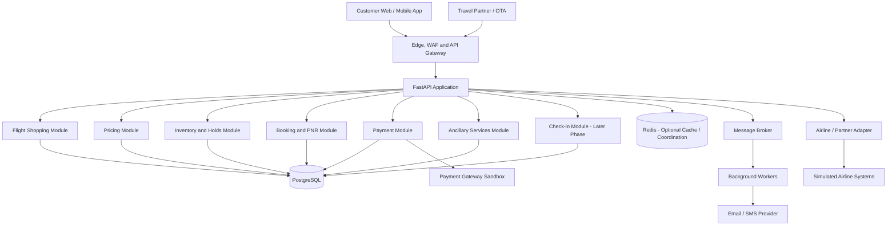

# Airline Reservation Platform — Project Design Document

**Working title:** Navitaire-Inspired Airline Reservation Platform  
**Reference airline:** IndiGo (illustrative business example only)  
**Status:** Planning and architecture baseline — implementation deferred  
**Version:** 1.0  
**Date:** 23 October 2026

---

## 1. Purpose

This document captures the initial scope, architecture, engineering challenges, proposed technology stack, and phased implementation plan for a future airline reservation platform.

The platform will be inspired by the capabilities commonly found in airline reservation and retailing systems, including Navitaire's published product capabilities. It will be our own implementation. It is **not** a reproduction of Navitaire's proprietary internals, and this document does not assert that IndiGo uses the exact architecture described here.

The project is being documented now; development will begin later.

## 2. Project vision

Build a modular, reliable airline booking platform that can support:

- Flight shopping and availability search
- Fare quotation and pricing rules
- Flight inventory management
- Temporary reservation holds
- Passenger and booking management
- PNR generation and retrieval
- Payment processing and reconciliation
- Cancellation and refund workflows
- Ancillary services such as baggage, seat selection, and meals
- Distribution APIs for web, mobile, and travel partners
- Check-in and boarding workflows in later phases
- Monitoring, auditability, security, and operational recovery

### 2.1 Initial project assumptions

Unless these assumptions are changed before implementation, the first version will use:

- **Goal:** A realistic end-to-end engineering project and demonstration platform.
- **Backend architecture:** Modular monolith, with clear module boundaries.
- **Backend framework:** Python and FastAPI.
- **Primary database:** PostgreSQL.
- **Initial inventory model:** Capacity-based inventory; physical seat maps and individual seat assignments will be added later.
- **External systems:** Simulated airline operations and partner APIs at first.
- **Deployment direction:** Docker-based deployment, with Azure as a possible target.
- **Implementation status:** Not started; this document is a planning baseline.

## 3. Scope

### 3.1 In scope

1. Airport and flight schedule management
2. Dated flight instances
3. Flight search and availability responses
4. Fare products, price quotations, and expiry
5. Inventory allocation and temporary holds
6. Passenger and itinerary management
7. Booking lifecycle and PNR
8. Payment gateway sandbox integration
9. Idempotency and duplicate-request protection
10. Cancellation, refund, and reconciliation workflows
11. Email/SMS notification adapters
12. Ancillary products in a later phase
13. Partner-facing API design in a later phase
14. Check-in and boarding workflows in a later phase
15. Automated tests, load tests, logging, monitoring, and recovery procedures

### 3.2 Out of scope for the first version

- Direct access to IndiGo's private or production systems
- Recreating Navitaire's proprietary software
- Operating a real airline or making operational flight decisions
- Real-world ticket issuance without an authorized airline/ticketing integration
- Live OTA distribution contracts
- Airport hardware and production departure-control integration
- Advanced revenue management and airline-grade dynamic pricing
- Full loyalty, interline, codeshare, and disruption-management capabilities
- Handling raw payment-card data directly

These capabilities may be evaluated later if the project obtains the required partnerships, specifications, approvals, and operational support.

## 4. High-level architecture



This is a logical architecture. It does not require each module to be a separately deployed service. The first implementation should be a modular monolith to simplify transactions, testing, deployment, and debugging. Modules may be extracted into services only when there is a clear operational or organizational reason.

### 4.1 Main layers

| Layer | Responsibility |
|---|---|
| Client applications | Flight search, passenger details, payment initiation, booking management |
| Edge and API layer | HTTPS, routing, request limits, security controls, API versioning |
| Application modules | Search, pricing, inventory, bookings, payments, ancillaries, check-in |
| Transactional database | Durable booking, inventory, payment, and audit records |
| Cache | Short-lived search data and carefully selected coordination use cases |
| Message broker and workers | Notifications, reconciliation, retries, and asynchronous tasks |
| Integration adapters | Payment provider, simulated airline systems, and future partner APIs |
| Observability | Structured logs, metrics, traces, alerts, and audit trails |

## 5. Core modules and responsibilities

### 5.1 Flight shopping

- Accept origin, destination, departure date, passenger counts, and search options.
- Find applicable flight instances and return itinerary options.
- Show indicative availability and fares.
- Support pagination, validation, and sensible request limits.
- Treat search results as potentially stale.

### 5.2 Pricing and fare rules

- Represent fare products and their conditions.
- Calculate base fare, taxes, fees, discounts, and optional-service charges.
- Produce a price quotation with a unique ID, currency, calculation breakdown, and expiry time.
- Revalidate price and availability before the booking is committed.
- Preserve a record of the quoted and accepted price for audit purposes.

### 5.3 Inventory and reservation holds

- Track sellable capacity for each dated flight instance and relevant inventory bucket.
- Create holds with explicit expiry timestamps.
- Atomically allocate or release capacity.
- Prevent concurrent requests from selling more inventory than is available in the platform's model.
- Reclaim expired holds safely.
- Keep physical seat assignment separate from capacity allocation.

**Critical invariant:** The platform must not confirm more inventory than it is authorized to sell. A cache must not be the authority for final inventory allocation.

### 5.4 Booking and PNR

- Create bookings associated with passengers and itinerary segments.
- Generate a unique booking reference/PNR according to the project's chosen format.
- Track booking lifecycle and history.
- Support retrieving a booking through an authorized API.
- Distinguish booking confirmation from ticket issuance where the integration model requires it.

A PNR is a booking reference; it should not be treated as equivalent to a payment transaction or a ticket number.

### 5.5 Payment

- Integrate with a payment gateway sandbox initially.
- Store gateway references and transaction states, not raw card security data.
- Use idempotency keys to protect against repeated payment requests.
- Verify payment status through trusted server-side responses or gateway status queries.
- Reconcile uncertain outcomes and support refunds when required.
- Keep booking status and payment status as separate state machines.

### 5.6 Ancillary services

Later capabilities may include:

- Seat selection and seat changes
- Checked baggage and extra baggage
- Meals and other optional services
- Fare bundles and promotions
- Ancillary payment and refund rules

Ancillary inventory and eligibility must be checked again at purchase time.

### 5.7 Distribution APIs

- Provide versioned APIs for first-party clients and authorized partners.
- Define authentication, rate limits, request/response contracts, error codes, and idempotency behavior.
- Use adapters to isolate external partner-specific protocols.
- Avoid assuming that an airline's private APIs are publicly available.

### 5.8 Check-in and boarding

A later phase can introduce check-in eligibility, passenger check-in records, boarding-pass generation, and boarding status. A production deployment would require integration with appropriate airline and airport operational systems and validation of applicable requirements.

## 6. Illustrative booking workflow

Example: two adults search for a flight from Delhi (DEL) to Bengaluru (BLR) on a selected date.

1. The client submits a flight search request.
2. The shopping module returns candidate itineraries and indicative offers.
3. The customer selects an offer.
4. The backend revalidates price and inventory.
5. The inventory module creates a temporary hold if capacity is available.
6. The booking module records a pending booking and its passengers/itinerary.
7. The payment module initiates a payment using an idempotency key.
8. The backend verifies the payment result.
9. The reservation is confirmed according to the configured booking state machine.
10. The system completes the applicable ticketing step, if supported by the integration.
11. An event or durable background task triggers email/SMS notification.
12. Reconciliation processes resolve uncertain payment or booking outcomes.

The exact ordering of reservation confirmation and ticket issuance depends on the integration model. The first version should define and test one explicit workflow rather than assume every airline uses the same sequence.

## 7. Booking state and payment state

Keep booking and payment states separate.

Illustrative booking states:

```text
DRAFT
  -> HELD
  -> PENDING_PAYMENT
  -> CONFIRMED
  -> CANCEL_PENDING
  -> CANCELLED
```

Possible exception states include `HOLD_EXPIRED`, `PAYMENT_REVIEW`, and `BOOKING_FAILED`. The final state model must define allowed transitions and recovery behavior.

Illustrative payment states:

```text
CREATED
  -> PENDING
  -> SUCCEEDED
  -> REFUND_PENDING
  -> REFUNDED
```

Alternative outcomes include `FAILED`, `UNKNOWN`, and `PARTIALLY_REFUNDED`.

These are starting examples, not a complete universal state machine. State transitions should be validated in application logic and supported by database constraints where possible.

## 8. Main database entities

The following is an initial conceptual model, not a final migration-ready schema.

| Entity | Purpose |
|---|---|
| `airports` | Airport code, name, city, timezone, and metadata |
| `aircraft` | Aircraft model and configuration reference |
| `flight_definitions` | Reusable flight number, route, and schedule definition |
| `flight_instances` | A specific scheduled departure on a specific date |
| `fare_products` | Fare type, price rules, restrictions, and entitlements |
| `price_quotes` | Quoted price breakdown, currency, and expiry |
| `inventory` | Sellable capacity and allocation counters by flight/bucket |
| `inventory_holds` | Temporary allocation, expiry, and lifecycle |
| `bookings` | PNR/reference, lifecycle state, totals, and timestamps |
| `passengers` | Passenger details associated with a booking |
| `itinerary_segments` | Flight instances and segment order for a booking |
| `payment_attempts` | Gateway reference, idempotency key, amount, and status |
| `refunds` | Refund request, gateway reference, amount, and status |
| `ancillary_catalog` | Available ancillary products and rules |
| `booking_ancillaries` | Ancillaries selected for passengers/segments |
| `checkins` | Check-in state and related references, added later |
| `outbox_events` | Durable events awaiting publication |
| `audit_events` | Security- and business-relevant activity history |

### 8.1 Important data-model decisions

- A flight definition differs from a dated flight instance.
- A booking can contain multiple passengers and itinerary segments.
- Payment attempts and refunds must be represented independently from bookings.
- Currency and monetary precision must be explicit; avoid floating-point arithmetic for money.
- All timestamps must have a clear timezone policy. Store event timestamps consistently (commonly UTC) while preserving airport-local schedule semantics.
- Use foreign keys, unique constraints, check constraints, and indexes intentionally.
- Define retention, privacy, and audit policies before production deployment.

## 9. REST API outline

Proposed API paths for planning; exact request/response schemas will be defined during implementation.

| Method | Endpoint | Purpose |
|---|---|---|
| `GET` | `/api/v1/flights/search` | Search flight instances |
| `POST` | `/api/v1/price-quotes` | Create a fare quotation |
| `GET` | `/api/v1/price-quotes/{quote_id}` | Retrieve a quote |
| `POST` | `/api/v1/inventory/holds` | Create a temporary inventory hold |
| `GET` | `/api/v1/inventory/holds/{hold_id}` | Retrieve hold status |
| `POST` | `/api/v1/bookings` | Create a pending booking |
| `GET` | `/api/v1/bookings/{booking_ref}` | Retrieve a booking, with authorization |
| `POST` | `/api/v1/bookings/{booking_ref}/payments` | Initiate payment |
| `POST` | `/api/v1/payments/webhook` | Receive verified payment-provider events |
| `POST` | `/api/v1/bookings/{booking_ref}/cancellations` | Request cancellation |
| `GET` | `/api/v1/payments/{payment_id}` | Retrieve payment status |
| `POST` | `/api/v1/refunds` | Initiate a permitted refund |
| `GET` | `/health/live` | Liveness check |
| `GET` | `/health/ready` | Readiness check |

For state-changing endpoints, define authentication, authorization, idempotency, validation, error semantics, and audit behavior. Do not expose a booking solely because a caller knows its reference.

## 10. Main engineering challenges and mitigations

### 10.1 Concurrent inventory allocation

**Risk:** Two requests read the same remaining capacity and both attempt to allocate it.

**Mitigations:**
- Use atomic conditional updates or appropriate row locking/transactions.
- Make inventory allocation and hold creation safe under concurrency.
- Define unique constraints and idempotency rules.
- Test races using concurrent integration tests.
- Do not rely on a cache or a prior search response for final availability.

### 10.2 Payment succeeds but booking confirmation is uncertain

**Risk:** A timeout leaves the application unsure whether the gateway charged the customer or whether the reservation was confirmed.

**Mitigations:**
- Track payment and booking states independently.
- Verify gateway status through trusted server-side mechanisms.
- Use idempotency keys and deduplicate webhook/event processing.
- Maintain reconciliation jobs for unknown or stuck states.
- Define when to retry, release a hold, escalate for review, or refund.

### 10.3 Duplicate requests and event delivery

**Risk:** Client retries or message redelivery trigger duplicate operations.

**Mitigations:**
- Use idempotency keys with a defined scope and retention period.
- Enforce uniqueness in the database where appropriate.
- Use a transactional outbox pattern for reliable event publication.
- Make event consumers idempotent.
- Avoid claiming end-to-end “exactly once” behavior across independent systems.

### 10.4 Pricing and fare rules

**Risk:** The final price differs from the displayed offer or rules are applied inconsistently.

**Mitigations:**
- Store quote breakdowns and expiry.
- Revalidate offers before booking.
- Use explicit, testable pricing rules.
- Record accepted price and currency.
- Test taxes, rounding, discounts, passenger categories, and ancillary pricing.

### 10.5 Flight changes and cancellations

**Risk:** Schedule or operational changes affect existing itineraries.

**Mitigations:**
- Separate scheduled times from actual operational status.
- Maintain change history.
- Design passenger notification and exception workflows.
- Add rebooking/refund support only after the core booking lifecycle is stable.

### 10.6 External integrations

**Risk:** A payment, messaging, airline, or partner service is slow or unavailable.

**Mitigations:**
- Isolate integrations behind adapters.
- Apply timeouts and bounded retries.
- Use circuit breakers where appropriate.
- Track correlation IDs and provider references.
- Reconcile outcomes that cannot be determined immediately.
- Start with simulators and sandboxes.

### 10.7 Security and privacy

**Risk:** Passenger data or booking actions are exposed to unauthorized users.

**Mitigations:**
- Apply least-privilege authorization and secure session/token management.
- Encrypt data in transit and protect sensitive data at rest.
- Keep secrets in a secret manager, not source control.
- Rate-limit public endpoints and protect against abuse.
- Redact sensitive information from logs.
- Use a compliant payment provider and avoid storing raw card security codes.
- Define data retention, access auditing, and incident-response procedures.

### 10.8 Performance and availability

**Risk:** Search traffic overloads the database or causes booking latency.

**Mitigations:**
- Measure before scaling.
- Index and optimize search queries.
- Cache only suitable, time-sensitive read data.
- Keep booking writes transactionally correct.
- Use queues for non-critical asynchronous work.
- Load-test peak traffic and database contention.
- Establish monitoring, alerting, backups, and recovery objectives.

## 11. Proposed technology stack

| Area | Initial choice | Notes |
|---|---|---|
| Language | Python | Primary backend language |
| API framework | FastAPI | REST API and request validation |
| Database | PostgreSQL | Primary transactional store |
| ORM | SQLAlchemy 2.x | Explicit transaction/session handling |
| Schema migrations | Alembic | Version-controlled schema evolution |
| Cache/coordination | Redis, optional initially | Never the sole source of truth for confirmed inventory |
| Background work | RabbitMQ and workers, when needed | Notifications and reconciliation |
| Frontend | React or Next.js | Customer/admin interfaces |
| Containers | Docker | Reproducible local and deployed environments |
| Cloud | Azure, optional target | Managed database, secrets, monitoring, hosting |
| Tests | pytest | Unit, integration, concurrency, and regression tests |
| Observability | Structured logs, metrics, tracing | Correlation IDs and alerting |

Start with a modular monolith and one authoritative transactional database. Introduce microservices, additional databases, and more infrastructure only when measurable requirements justify them.

## 12. Proposed repository structure

An initial project structure could look like this:

```text
airline-reservation-platform/
├── app/
│   ├── main.py
│   ├── core/
│   │   ├── config.py
│   │   ├── security.py
│   │   ├── logging.py
│   │   └── errors.py
│   ├── api/
│   │   └── v1/
│   │       ├── flights.py
│   │       ├── quotes.py
│   │       ├── holds.py
│   │       ├── bookings.py
│   │       ├── payments.py
│   │       └── health.py
│   ├── modules/
│   │   ├── shopping/
│   │   ├── pricing/
│   │   ├── inventory/
│   │   ├── reservations/
│   │   ├── payments/
│   │   ├── ancillaries/
│   │   └── checkin/
│   ├── integrations/
│   │   ├── payment_gateway/
│   │   ├── airline_adapter/
│   │   └── notifications/
│   ├── db/
│   │   ├── models/
│   │   ├── repositories/
│   │   └── session.py
│   └── workers/
├── migrations/
├── tests/
│   ├── unit/
│   ├── integration/
│   ├── concurrency/
│   └── contract/
├── docs/
├── scripts/
├── docker-compose.yml
├── alembic.ini
├── pyproject.toml
├── .env.example
└── README.md
```

This is a suggested future structure, not an existing verified codebase. It can be adjusted when implementation begins.

## 13. Testing and acceptance criteria

The project should not be considered ready merely because its APIs return successful responses.

### Core correctness tests

- Search returns only eligible flight instances for the requested criteria.
- Quotes preserve fare breakdown, currency, and expiry.
- Inventory cannot be over-allocated under concurrent requests.
- Expired holds are released safely and cannot be reused.
- Repeated booking/payment requests do not create duplicate operations.
- Booking and payment states transition only through permitted paths.
- Failed or ambiguous payment outcomes can be reconciled.
- Cancellation/refund operations are authorized and auditable.
- Passenger and booking details are protected by access control.

### Reliability tests

- Payment provider timeout and webhook duplication
- Database transaction rollback
- Worker crash and message redelivery
- Notification provider outage
- Cache outage or stale cache values
- Application restart during a pending booking
- Hold expiry during a payment attempt
- Database backup restoration and documented recovery

### Performance tests

Set target throughput and latency only after defining expected traffic and test environment. Measure search latency, booking latency, database contention, error rate, and behavior under load rather than inventing performance guarantees.

## 14. Development roadmap

### Phase 1 — Core booking foundation
- Define requirements and domain model.
- Create PostgreSQL schema and migrations.
- Implement airports, schedules, and flight instances.
- Implement search and price quotation.
- Implement concurrency-safe inventory holds.
- Implement booking creation and PNR retrieval.
- Add unit and integration tests.

### Phase 2 — Payment and recovery
- Integrate payment sandbox.
- Implement booking/payment state machines.
- Add idempotency and webhook verification.
- Implement reconciliation and refund workflows.
- Add notifications through background workers.

### Phase 3 — Retailing features
- Add baggage, seat selection, meals, and fare bundles.
- Add booking changes and cancellation rules.
- Add administration and reporting features.

### Phase 4 — Distribution and operations
- Add partner API contracts and adapters.
- Add simulated check-in and boarding workflows.
- Evaluate authorized real integrations.
- Complete operational, privacy, and security reviews.

### Phase 5 — Production hardening
- Load and fault-injection tests.
- Monitoring and alerting.
- Backup restoration and disaster recovery.
- Security assessment and deployment runbooks.
- Define service-level objectives based on actual requirements.

## 15. Decisions to revisit before development

The following questions remain open and should be answered before implementation:

1. Is the initial goal a learning/demo project or a commercial platform?
2. Will inventory remain capacity-based in the first release, or must individual seat assignment be supported immediately?
3. Which payment gateway sandbox will be used?
4. Will airline and partner operations remain simulated, or are authorized integrations available?
5. What are the expected traffic levels and latency targets?
6. Which cancellation, refund, and fare rules should the initial demonstration support?
7. Is Azure the deployment target from the first release?
8. What passenger data is essential, and what privacy/retention requirements apply?

Recommended starting point: a learning/demo project, capacity-based inventory, simulated integrations, FastAPI, PostgreSQL, and a modular monolith.

## 16. Important terminology

- **PSS (Passenger Service System):** A broad term for systems supporting passenger reservations and related airline services.
- **PNR (Passenger Name Record):** A booking record/reference associated with passenger and itinerary details.
- **Inventory:** Sellable capacity associated with a flight and its applicable allocation rules.
- **Fare product:** A priced offer with conditions and entitlements.
- **Ancillary:** An optional service such as baggage, a seat, or a meal.
- **OTA (Online Travel Agency):** A third-party travel booking platform.
- **Idempotency:** A property that allows a repeated request to avoid repeating the same business effect.
- **Reconciliation:** Comparing records across systems to resolve missing, delayed, or uncertain outcomes.
- **Transactional outbox:** A pattern that records business changes and events together in a database transaction, allowing reliable later publication.
- **DCS (Departure Control System):** A system used for operational departure processes such as check-in and boarding, depending on the airline's environment.

## 17. Reference links

These links provide background on the industry and commercial product capabilities. They do not imply access to proprietary implementation details.

- Navitaire: https://navitaire.com/
- Amadeus: https://amadeus.com/
- IATA: https://www.iata.org/
- FastAPI documentation: https://fastapi.tiangolo.com/
- PostgreSQL documentation: https://www.postgresql.org/docs/
- SQLAlchemy documentation: https://docs.sqlalchemy.org/
- Alembic documentation: https://alembic.sqlalchemy.org/
- Redis documentation: https://redis.io/docs/
- RabbitMQ documentation: https://www.rabbitmq.com/docs
- Azure documentation: https://learn.microsoft.com/azure/

---

## Final note

This document is the project's initial architecture and planning baseline. It is not a claim that the system has been implemented, deployed, load-tested, or integrated with IndiGo or Navitaire.

When development begins, first finalize the open decisions, then build and test the inventory and booking transaction model before adding payment complexity or external integrations.
