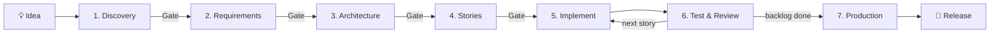

# 🚀 BMAD + Claude Code: New Project Playbook

> **From raw idea to production release using AI-driven, gate-controlled development.**
> A repeatable, copy-paste workflow for starting, planning, building, testing and shipping a new application with [BMAD](https://docs.bmad-method.org/) and [Claude Code](https://docs.anthropic.com/en/docs/claude-code/overview).

| | |
|---|---|
| 🎯 **Audience** | Intermediate developers building scalable, production-ready apps (web, mobile and/or backend) |
| ⏱️ **Setup time** | ~15 minutes |
| 🔁 **Reusable** | Yes. Replace `{{IDEA}}` and follow the phases in order |
| ⚠️ **Rule #1** | Start with discovery, **not** code generation |

---

## 📑 Table of Contents

1. [How It Works](#-how-it-works)
2. [Quick Start (TL;DR)](#-quick-start-tldr)
3. [Prerequisites](#-prerequisites)
4. [Setup: Project, BMAD, Claude Code](#-setup-project-bmad-claude-code)
5. [The 7-Phase Workflow](#-the-7-phase-workflow)
   - [Phase 1: Discovery & Validation](#phase-1--discovery--idea-validation)
   - [Phase 2: Product Requirements](#phase-2--product-requirements)
   - [Phase 3: UX & Architecture](#phase-3--ux--technical-architecture)
   - [Phase 4: Epics & Stories](#phase-4--epics--stories)
   - [Phase 5: Implementation](#phase-5--implement-one-story-at-a-time)
   - [Phase 6: Testing & QA](#phase-6--testing--quality-assurance)
   - [Phase 7: Production Readiness](#phase-7--production-readiness)
6. [Master Prompt (copy-paste)](#-master-prompt)
7. [Git Workflow](#-git-workflow)
8. [Golden Rules](#-golden-rules)
9. [Troubleshooting & Updates](#-troubleshooting--updates)
10. [References](#-references)

---

## 🧠 How It Works

BMAD turns Claude Code into a structured team of specialist roles (analyst, PM, architect, scrum master, developer, QA). Every phase produces a **written artifact** you review and approve (a **gate**) before the next phase begins. Nothing gets built on unvalidated assumptions.



| Phase | Output artifact | Your approval gate |
|:--:|---|---|
| 1 | Discovery brief, MVP definition | Problem, user, demand evidence, MVP, risks |
| 2 | Product requirements (functional and non-functional) | Requirements describe *what* and *how success is measured* |
| 3 | UX design and architecture | Architecture, data model, authorization, deployment and cost |
| 4 | Epics and stories backlog | Initial backlog and first story selected |
| 5 | Working, tested code (one story) | Implementation plan approved before coding |
| 6 | Review and test report | All critical acceptance criteria met |
| 7 | Deployment and operations checklist | Staging verified, release checks passed |

---

## ⚡ Quick Start (TL;DR)

```bash
mkdir my-product && cd my-product   # 1. new directory per project
git init                            # 2. new repo
npx bmad-method install             # 3. install BMAD (pick Claude Code)
claude                              # 4. open Claude Code
```

Then paste the [Master Prompt](#-master-prompt) with your idea and follow the gates. 👇

---

## 🧰 Prerequisites

| Tool | Minimum version | Verify with |
|---|---|---|
| Node.js (includes npm) | 20.12+ | `node --version` / `npm --version` |
| Git | any recent | `git --version` |
| Python | 3.10+ | `python --version` |
| uv (Python package manager) | latest | `uv --version` |
| Claude Code (authenticated) | latest | `claude --version` |

Run all checks in one go:

```bash
node --version && npm --version && git --version && python --version && uv --version && claude --version
```

> 💡 If a command is missing, install that tool from its official documentation, then re-run the checks.

---

## 🛠️ Setup: Project, BMAD, Claude Code

### Step 1: Create an isolated project

Use **one directory and one Git repository per application**. Never reuse another project's source code or planning documents unless intentionally needed.

```bash
mkdir my-product        # replace with your project name
cd my-product
git init
```

> ✅ Confirm your terminal is in the correct directory *before* installing BMAD.

### Step 2: Install BMAD

```bash
npx bmad-method install
```

In the interactive installer:

- [ ] Select the modules your project needs. For most apps, start with **core BMAD** plus the **BMad Method (BMM)** planning and delivery workflows. Add specialist modules later.
- [ ] Select **Claude Code** as the AI coding environment.
- [ ] Choose the **stable** release channel.
- [ ] Review the module configuration and **output locations**.

<details>
<summary>🔒 <b>Security and version policy (click to expand)</b></summary>

- Prefer the **stable** release for production-oriented projects. Avoid preview releases unless you deliberately want to test them.
- If the installer shows a security warning, **read it**.
- Install only trusted modules, and inspect unfamiliar custom skills before letting them execute.
- Check the [official docs](https://docs.bmad-method.org/) before upgrading or switching channels.

</details>

### Step 3: Open the project in Claude Code

```bash
claude
```

Check which BMAD skills or commands your installation provides. If your version includes the `bmad setup` and help skill, verify the install:

```text
Run bmad setup.
Verify the installation and show the installed module versions.
Explain the available planning and implementation workflows.
Do not generate application code yet.
```

> ⚠️ **Version awareness:** the classic **v6** workflow and newer versions use different skill names and slash commands. Follow the documentation and commands shown by *your installed skills*. Never assume a command from a tutorial exists in your version.
>
> 📝 **Record the installed versions** so future updates are deliberate.

### Step 4: Define your project input

Fill in this template. You'll reuse it in the Master Prompt.

```text
APPLICATION IDEA:
{{IDEA}}

PROJECT CONTEXT:
- Developer experience : Intermediate
- Project stage        : New project
- AI coding tool       : Claude Code
- Development method   : BMAD
- Target               : Scalable, production-ready application
- Platform             : Determine whether web, mobile, or both are justified
- Budget               : Ask if unknown
- Timeline             : Ask if unknown
- Target users         : Discover if unknown
- Monetization         : Discover if relevant
```

> 🧭 An idea is **not** a validated business opportunity. Always start with discovery.

---

## 🧭 The 7-Phase Workflow

Run the phases **in order**. At each phase: paste the prompt, answer the questions, review the artifacts, then pass the gate.

### Phase 1 · 🔍 Discovery & Idea Validation

**Goal:** Prove the problem is real and find the smallest useful MVP *before* writing code.

Start the BMAD brainstorming or idea-discovery workflow in your installation, then give it this prompt:

```text
I want to start a new software project.

My idea is:
{{IDEA}}

Act as a product discovery facilitator.

Before writing code:
1. Clarify the problem and target users.
2. Identify the users' current alternatives.
3. Ask focused questions about the problem, business goals,
   budget, timeline, and access to potential users.
4. Identify assumptions and major risks.
5. Research competitors and demand when appropriate.
6. Recommend a low-cost validation experiment.
7. Identify the smallest useful MVP.
8. Explain which features should be excluded from the first release.

If the idea is vague, help me refine it instead of inventing
unconfirmed requirements.

Ask one focused question at a time.
Do not choose the final architecture or write application code.

Save the resulting discovery artifacts using the configured
BMAD output conventions.
```

> ### 🚦 Gate 1: Review before continuing
> - [ ] Problem statement is clear
> - [ ] Target user is defined
> - [ ] Evidence of demand exists, **or** a validation plan does
> - [ ] MVP is proposed and minimal
> - [ ] Business and technical risks are listed
>
> **If the idea is weak or too broad, refine it. Don't proceed.**

---

### Phase 2 · 📋 Product Requirements

**Goal:** Define *what* the product does and *how success is measured*.

```text
Based on the approved discovery findings, help me define
the product requirements.

Produce or update the appropriate BMAD requirements artifacts.

Include:
- Product vision and measurable goals
- User personas and user journeys
- Functional requirements
- Non-functional requirements
- User stories and acceptance criteria
- Permissions and roles
- Error and empty states
- Accessibility requirements
- Privacy and security requirements
- Performance and reliability expectations
- MVP scope and explicit exclusions
- Risks, dependencies, and unresolved questions

Distinguish confirmed decisions from assumptions.

Do not silently resolve important business questions.
Ask me when a decision materially affects the product.

Do not implement code until I approve the requirements.
```

> ### 🚦 Gate 2
> - [ ] Requirements state what the product does **and** measurable success criteria
> - [ ] Confirmed decisions are separated from assumptions
> - [ ] The initial release is small enough to implement and test incrementally

---

### Phase 3 · 🏗️ UX & Technical Architecture

**Goal:** Choose the simplest architecture that meets the requirements and can evolve safely.

```text
Design a maintainable architecture based on the approved
product requirements.

Evaluate the need for:
- Web frontend
- Mobile application
- Backend/API
- Database and data migrations
- Authentication and authorization
- File or media storage
- Notifications and background jobs
- Third-party integrations
- Analytics and observability
- CI/CD and deployment

For each important technology decision:
1. Explain the problem it solves.
2. Compare reasonable alternatives.
3. Explain the cost and operational trade-offs.
4. Identify scaling and security implications.
5. Recommend a solution appropriate for the expected MVP.

Define:
- System architecture
- Data model and relationships
- API contracts
- Application boundaries
- Authentication and access-control model
- Testing strategy
- Environment configuration
- Deployment and backup strategy

Prefer the simplest architecture that meets the requirements
and can evolve safely.

Do not introduce microservices or unnecessary infrastructure
without a clear reason.

Ask me to approve major technical decisions before coding.
```

> ### 🚦 Gate 3
> - [ ] Architecture diagram and data model reviewed
> - [ ] Authorization strategy reviewed
> - [ ] Deployment approach and **cost** implications accepted
> - [ ] Web/mobile choices justified by real product needs, not trends

---

### Phase 4 · 🧩 Epics & Stories

**Goal:** Convert requirements and architecture into small, testable, ordered work items.

```text
Break the approved requirements and architecture into
epics and implementation stories.

For every story, define:
- User value
- Scope and exclusions
- Dependencies
- Acceptance criteria
- Relevant data and API changes
- Authorization requirements
- Required tests
- Definition of done

Prioritize the stories needed to deliver a complete vertical
slice of the application.

Keep stories small enough to implement, review, and test.

Identify the critical path and major technical risks.
Do not generate one oversized story for the entire application.

Save the plan and tracking artifacts using BMAD conventions.
```

> 💡 **Good first vertical slice:** one user journey from UI → backend → database, with validation and tests.

> ### 🚦 Gate 4
> - [ ] Initial backlog approved
> - [ ] First story selected

---

### Phase 5 · 🔨 Implement One Story at a Time

**Goal:** Ship small, verified increments. Use the installed BMAD build workflow (for example `bmad-build`, where available).

```text
Implement the next approved story.

Before changing files:
1. Read the relevant requirements and architecture.
2. Inspect the existing codebase.
3. Review the story and acceptance criteria.
4. Identify affected components and dependencies.
5. Propose an implementation plan.

Wait for my approval of the plan.

Then implement only the approved scope.
Follow the established coding conventions.
Add or update appropriate automated tests.
Run relevant lint, type-check, test, and build commands.
Inspect the resulting changes for security and regressions.

Report:
- Files changed
- Decisions made
- Tests executed and their actual results
- Any failures or unresolved issues
- Any deviation from the approved design

Do not claim success when a check has not been run.
Do not silently expand the scope.
```

🔁 **Loop per story:** plan → approve → implement → review diff → run tests → commit verified work.

> ### 🚦 Gate 5 (per story)
> - [ ] Plan approved *before* code was written
> - [ ] Diff reviewed, tests pass, scope not expanded
> - [ ] Verified work committed

---

### Phase 6 · ✅ Testing & Quality Assurance

**Goal:** Verify behavior against the approved story, including failure cases.

```text
Review the implemented feature against its approved story.

Check:
- Functional correctness
- Acceptance criteria
- Input validation
- Authentication and authorization
- Data isolation
- Error handling
- Database consistency
- Accessibility
- Performance concerns
- Test coverage
- Unintended changes

Run the relevant tests and report the real results.

Fix confirmed issues within the approved scope.
Request clarification when a fix requires a design decision.

Do not mark the story complete while critical acceptance
criteria remain unmet.
```

**Test pyramid for the full application:**

| Level | Covers |
|---|---|
| 🧪 Unit | Business logic, validators, utilities |
| 🔗 Integration | API ↔ database, auth, external-service boundaries |
| 🌐 End-to-end | Critical user journeys through the real UI |
| 🚫 Negative cases | Unauthorized access, invalid input, failing external services |

---

### Phase 7 · 🚢 Production Readiness

**Goal:** Prove it's safe to release. A green local build is **not** proof.

Ask BMAD to produce a deployment and operations checklist covering:

- [ ] Production hosting and database configuration
- [ ] Secret management (no secrets in source control)
- [ ] Secure authentication and authorization
- [ ] HTTPS and appropriate security controls
- [ ] Database migrations
- [ ] Backup **and restore** procedures
- [ ] Error logging and monitoring
- [ ] Rate limits and abuse protection where appropriate
- [ ] Dependency and vulnerability checks
- [ ] CI/CD pipeline
- [ ] Rollback and recovery procedures
- [ ] Production smoke tests
- [ ] Privacy and legal requirements relevant to your product

> ### 🚦 Gate 7: Release
> Deploy to **staging first**, verify the critical user journeys, and release only when every required check passes.

---

## 🎯 Master Prompt

After BMAD is installed, open Claude Code in the project and paste this. Replace `{{IDEA}}`.

```text
I am starting a new application project using BMAD.

My idea:
{{IDEA}}

Read this project's BMAD configuration and identify the
installed version and available workflows.

Help me follow this playbook in order:
1. Discovery and validation
2. Product requirements
3. UX and architecture
4. Epics and stories
5. Incremental implementation
6. Testing and review
7. Production readiness

Start with discovery.

Ask me one focused question at a time.
Do not write application code, select a final technology
stack, or skip approval gates before the relevant decisions
have been made.

Use the installed BMAD workflow appropriate to this project
and save artifacts in the configured project output directory.

Explain each step, record decisions, and tell me what I need
to review before proceeding.
```

---

## 🌿 Git Workflow

```bash
git status                              # check state before changes
git switch -c feature/short-description # branch for substantial changes

# after reviewing and testing:
git diff --check                        # catch whitespace errors
git diff                                # review every change
git status

git add <intended-files>                # stage only what you reviewed
git commit -m "Implement approved feature"
```

> 🔐 Replace `<intended-files>` with real paths. **Never** commit credentials, secrets, generated production data, or files you haven't reviewed.

---

## 🏆 Golden Rules

| # | Rule |
|:-:|---|
| 1 | **Discovery before code.** Validate the problem before a large implementation. |
| 2 | **Keep documents consistent.** Requirements, architecture and plans must agree. |
| 3 | **Gate every decision.** Get approval at each important decision point. |
| 4 | **Build incrementally.** One small story at a time. |
| 5 | **Test real behavior**, including failure cases. |
| 6 | **Secrets stay out of source control.** |
| 7 | **Avoid premature complexity.** No microservices "just in case". |
| 8 | **Record architectural decisions** so the *why* survives. |
| 9 | **AI output is a proposal.** Review it like a teammate's pull request. |
| 10 | **Keep artifacts in the BMAD output location** configured for the project. |
| 11 | **Check your installed BMAD version** before trusting an online tutorial's commands. |

---

## 🩺 Troubleshooting & Updates

<details>
<summary><b>A workflow or command is missing</b></summary>

Ask the installed BMAD helper to explain the available skills and their intended use. Check the official documentation **before** manually installing a similarly named skill.

</details>

<details>
<summary><b>How do I update BMAD?</b></summary>

Re-run the official installer and review its options before confirming:

```bash
npx bmad-method install
```

</details>

<details>
<summary><b>Starting a second project</b></summary>

Repeat this playbook in a **fresh directory**. Don't blindly reuse an old project's BMAD configuration or planning artifacts.

</details>

---

## 📚 References

| Resource | Link |
|---|---|
| BMAD documentation | https://docs.bmad-method.org/ |
| Installation guide | https://docs.bmad-method.org/start/install-bmad/ |
| First project guide | https://docs.bmad-method.org/start/build-your-first-change/ |
| BMAD repository | https://github.com/bmad-code-org/BMAD-METHOD |
| Claude Code docs | https://docs.anthropic.com/en/docs/claude-code/overview |

---

> ### 🎖️ Success criterion
> Every project starts with a **validated problem** and **approved requirements**, moves through an **explicit technical design** and **small implementation stories**, and reaches release only after **appropriate testing and production-readiness checks**.

*End of playbook.*
